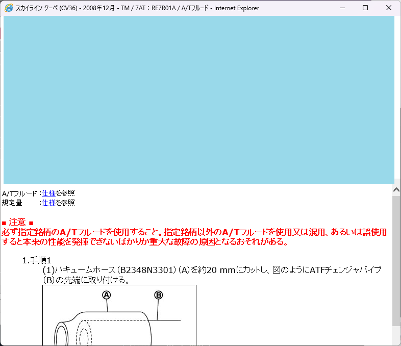

# NISSAN ESM Patch (Windows 11対応)

NISSAN ESM（日産電子サービスマニュアル）の Windows 11 環境での動作改善と、電子配線図（eWD）の表示に関する変更をまとめています。

## 概要

- ESM 本体の変更は **6項目** です。
- これに加えて、電子配線図（eWD）のウィンドウ、XML、一覧、SVG 表示を調整しています。
- このリポジトリには eWD の変更済みファイルや SVG 全体は含まれていません。eWD の変更は対象の ESM ファイルに別途適用する必要があります。

## 変更点

### `common.js`
- ファイルの先頭に2関数を追加します。

1. `StrConvNarrow(str)`
	- 文字列以外の入力を安全にスルー
	- 全角英数字/記号を半角へ変換
	- 全角スペースを半角スペースへ変換

2. `StrConvWide(str)`
	- 文字列以外の入力を安全にスルー
	- 半角英数字/記号を全角へ変換
	- 半角スペースを全角スペースへ変換

```javascript
function StrConvNarrow(str) {
	if (typeof str !== 'string') return str;
	return str.replace(/[！-～]/g, function(s) {
		return String.fromCharCode(s.charCodeAt(0) - 0xFEE0);
	}).replace(/　/g, ' ');
}

function StrConvWide(str) {
	if (typeof str !== 'string') return str;
	return str.replace(/[!-~]/g, function(s) {
		return String.fromCharCode(s.charCodeAt(0) + 0xFEE0);
	}).replace(/ /g, '　');
}
```

### `sieOpen.js`

3. `fncSieOpen(url)`を差し替え
	- 参照値取得時の例外を吸収して異常終了を回避
	- 画面サイズ/位置計算の安全化
	- `window.open` 後のフォーカス処理を安全化
	- `session` 未定義環境でもエラーにならないよう防御

```javascript
function fncSieOpen(url) {
	url = url + "&PageOpenMode=";
	// エラー回避のための安全な値取得
	var chkVal = "";
	try { chkVal = this.document.sietree.checkboxvalue.value; } catch(e){}
	url = url + chkVal;

	var winName = "ESMSUB";
	var screen_width = window.screen.width;
	var screen_height = window.screen.height;

	// 丸カッコ () から 角カッコ [] に修正してエラーを回避
	var subwintop = 0;
	try { subwintop = window.parent.frames[0].screenTop; } catch(e){}
	var subwinleft = window.parent.screen.width - 792;
	var subwinwidth = 780;
	var subwinheight = fncGetSieHeight();

	if (screen_width <= 800) {
		try { subwintop = window.parent.frames[0].screenTop; } catch(e){}
		subwinleft = window.parent.screen.width - 752;
		subwinwidth = 740;
		subwinheight = fncGetSieHeight();
	} else if (screen_height <= 600) {
		subwinwidth = 710;
		subwinheight = fncGetSieHeight();
		subwinleft = 78;
		subwintop = 25;
	}

	var option = "toolbar=no,location=no,directories=no,status=no,menubar=no, ";
	option += "scrollbars=yes,resizable=yes,width=" + subwinwidth + ",height=" + subwinheight + ",left=" + subwinleft + ",top=" + subwintop;

	var oWin = window.open(url, winName, option);
	if (oWin) oWin.focus();

	// 未定義でエラーになるセッション処理を安全にスルーさせる
	try {
		if (typeof session !== 'undefined' && session.getAttribute) {
			var PagesOpened = session.getAttribute('PagesOpened') + 1;
			session.setAttribute('PagesOpened', PagesOpened);
		}
	} catch(e){}
}
```

### `pcvehiclepage.hta`

4.  `moveTo`,`resizeTo`をコメントアウト
```
	//esm_win.moveTo(0,0);
	//esm_win.resizeTo(window.screen.availWidth,window.screen.availHeight);
```

### `index.html`

5. `moveTo`,`resizeTo`が含まれるブロックをコメントアウト
```
//window.resizeTo(window.screen.availWidth,window.screen.availHeight);
//if(request.getParameter("fromconsult") != "true" && request.getParameter("fromconsult") != true)
//{
//if((window.screen.Height)>640 && window.screen.width<860) 
//{
//window.moveTo(0,0);
//window.resizeTo(800,window.screen.height-20);
//}
//if((window.screen.height<640) && window.screen.width > 800)
//{
//window.moveTo(0,0);
//window.resizeTo(window.screen.width,600-20);
//}
//else
//{
//window.resizeTo(window.screen.Width,window.screen.Height-20);
//}
//}
```

### `page\sie`配下の各html

6. tableタグの `height="100%"`の削除


- 青枠の部分が高さの解釈で変なので、`height="100%"`を削除する

- 対処方法：正規表現`\s+height=["']100%["']`でヒットするものをgrep置換する

## 電子配線図（eWD）の変更点

対象は `UP8JCV360J__/pages/start.html` から開く `UP8JCV360J__/images/svg/eWD/index.html` と、その先の画面です。以下の `common/` は `UP8JCV360J__/images/svg/eWD/common/` を指します。

### ウィンドウの最大化停止

- `UP8JCV360J__/pages/menu.html` の `Disp_eWD_TOP()` と、`common/script/global.js` の `Disp_eWD()`・`Disp_eWD_TOP()`・`Open_XML_Message()` から、ウィンドウの移動・最大化処理を削除します。
- `common/script/figinfo.js` の `FigData_ConnInfoLinkClick()`・`Serach_Junction()`、`common/script/listinfo.js` の `CateList_ClickFigure()`、`common/script/navi.js` の `navi_OnClickPdfbtn()` も同様に調整します。
- `CateList_ClickFigure()` で開くウィンドウには `resizable=yes` を指定します。

### MSXML のバージョン判定

「XMLパーサーのバージョン不正。」で処理が中止されないよう、従来の IE バージョン判定で対象外となる環境でも MSXML 3.0 を使うようにします。

- `common/script/global.js` の `MSXMLversion()` と `GetCategoryInfoFromSubcategory()`
- `common/script/listinfo.js` のカテゴリ一覧処理
- `common/script/figinfo.js` の `Find_jc_AllconnFrom()`・`Find_jc_AllconnTo()`・`Find_Sig_jc()`

### カテゴリ一覧の操作

`common/script/listinfo.js` を修正し、カテゴリ画面のセクション一覧で `childNodes[i]` と `getAttribute("name")` を使用します。要素以外のノードと見出しを除外し、三角アイコンの取得とループ変数の扱いも修正します。

### IE 標準の SVG 表示への対応

- `common/script/svg.js` で、SVG 内のイベントを表示元の HTML フレームへ転送し、読み込み完了フラグとツールチップの座標を調整します。
- `common/script/svgcon.js` で、コネクタ SVG の読み込み完了フラグを表示元へ設定します。
- `common/script/figinfo.js` の `SVGview_download_mesCLR()` で、SVG の読み込み完了を最大約30秒間再確認します。
- SVG の埋め込み MIME を `image/svg-xml` から `image/svg+xml` に変更します。対象は `common/xslt/figlist.xsl`、`common/xslt/connector.xsl`、`common/script/listinfo.js`、`common/script/figinfo.js` です。

変更後、実際の回路図で文字の表示を確認しています。コネクタ図など、回路図以外の動作は未確認です。

### SVG の XML 解析エラー

`UP8JCV360J__/images/svg/eWD/vehicle/` 以下の SVG では、ルート要素で使用する `ns_graphs` が未定義のため、DOCTYPE に次の定義を追加します。

```xml
<!ENTITY ns_graphs "http://ns.adobe.com/Graphs/1.0/">
```

確認した環境の対象は `circuit/svg` 53ファイル、`consvg` 491ファイル、`harness/svg` 9ファイル、`poeama/svg` 18ファイルの計571ファイルです。車種・収録内容によって対象数は異なる可能性があるため、適用先で確認してください。

### 調査中に変更した IE 設定

確認環境では、インターネット オプションの「GPU レンダリングでなく、ソフトウェア レンダリングを使用する」を有効にしています。対応する設定は `HKCU\Software\Microsoft\Internet Explorer\Main` の `UseSWRender` です。この設定が文字表示に必要かは未確認です。元に戻す場合は該当のチェックを外してください。

## 適用方法（概要）

対象環境の元ファイルをバックアップしたうえで、ESM 本体の6項目と、必要に応じて eWD の変更を対応箇所へ反映してください。eWD の変更済みファイルはこのリポジトリには含まれていないため、対象環境に合わせて別途用意してください。

## 注意事項

- 本パッチは Windows 11 での動作改善を目的としています。
- 運用環境の個別差異により、追加調整が必要になる場合があります。
- eWD 図上のドラッグによるスクロールは、動作しない可能性があります。
